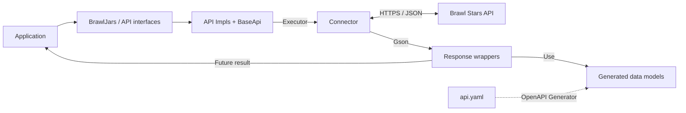

[](https://packagecloud.io/)
[](https://github.com/mlieshoff/brawljars/actions/workflows/nightlies.yml)

# brawljars 5.0.0

A Java client for the official Supercell Brawl Stars API, with asynchronous
requests, generated data models, and optional filesystem caching.

Requires Java 21. See the [changelog](CHANGELOG.md) for the 5.0.0 breaking changes.

- [Installation](#installation)
- [Quick start](#quick-start)
- [Requests and responses](#requests-and-responses)
- [API reference](#api-reference)
- [Connectors and custom APIs](#connectors-and-custom-apis)
- [Migrating from 4.x](#migrating-from-4x)
- [Development](#development)
- [Community](#community)

## Installation

Add the packagecloud repository and dependency to your Maven project:

```xml
<repositories>
    <repository>
        <id>packagecloud-brawljars</id>
        <url>https://packagecloud.io/mlieshoff/brawljars/maven2</url>
    </repository>
</repositories>

<dependencies>
    <dependency>
        <groupId>brawljars</groupId>
        <artifactId>brawljars</artifactId>
        <version>5.0.0</version>
    </dependency>
</dependencies>
```

For Gradle:

```groovy
repositories {
    maven { url = uri('https://packagecloud.io/mlieshoff/brawljars/maven2') }
    mavenCentral()
}

dependencies {
    implementation group: 'brawljars', name: 'brawljars', version: '5.0.0'
}
```

## Quick start

Create an API token through the [Brawl Stars developer portal](https://developer.brawlstars.com/)
and make it available as the `BRAWL_STARS_TOKEN` environment variable.
The standard connector adds the Bearer authorization header to requests.

```java
import brawljars.BrawlJars;
import brawljars.api.intern.brawlers.BrawlerApi;
import brawljars.api.intern.brawlers.BrawlersRequest;
import brawljars.api.intern.brawlers.BrawlersResponse;
import brawljars.essentials.connector.StandardConnector;

public class Example {
    public static void main(String[] args) throws Exception {
        String apiKey = System.getenv("BRAWL_STARS_TOKEN");
        if (apiKey == null || apiKey.isBlank()) {
            throw new IllegalStateException("Set BRAWL_STARS_TOKEN before running this example");
        }

        BrawlJars brawlJars = new BrawlJars(
                "https://api.brawlstars.com/v1", apiKey, new StandardConnector());
        BrawlerApi brawlers = brawlJars.getApi(BrawlerApi.class);
        BrawlersResponse response = brawlers.findAll(
                BrawlersRequest.builder().limit(5).storeRawResponse(true).build()).get();

        response.getItems().forEach(brawler -> System.out.println(brawler.getName()));
    }
}
```

Use `brawlJars.listApis()` to list registered API interfaces. The following examples
assume you already have a `BrawlJars` instance named `brawlJars`.

## Requests and responses

### Tagged resources

Pass the tag or ID to the request builder. The connector URL-encodes path
parameters, so a player tag can include its leading `#`.

```java
import brawljars.api.intern.players.PlayerApi;
import brawljars.api.intern.players.info.PlayerRequest;
import brawljars.api.intern.players.info.PlayerResponse;

PlayerApi players = brawlJars.getApi(PlayerApi.class);
PlayerResponse player = players.findById(
        PlayerRequest.builder("#28UP80RRY").storeRawResponse(true).build()).get();
```

### Pagination

Pagination requests expose `limit`, `after`, and `before`. Follow a response's
paging cursor with either `after` or `before` in the next request.

```java
import brawljars.api.intern.brawlers.BrawlerApi;
import brawljars.api.intern.brawlers.BrawlersRequest;
import brawljars.api.intern.brawlers.BrawlersResponse;

BrawlerApi brawlers = brawlJars.getApi(BrawlerApi.class);
BrawlersResponse page = brawlers.findAll(
        BrawlersRequest.builder().limit(5).build()).get();

if (page.getPaging() != null && page.getPaging().getCursors() != null) {
    String after = page.getPaging().getCursors().getAfter();
    if (after != null) {
        BrawlersResponse nextPage = brawlers.findAll(
                BrawlersRequest.builder().limit(5).after(after).build()).get();
    }
}
```

### Events and list responses

Event rotation is a top-level list of generated `ScheduledEvent` models.
Iterate the response directly. Battle logs and game modes instead expose their
generated elements through `getItems()`.

```java
import brawljars.api.intern.events.EventApi;
import brawljars.api.intern.events.EventRotationRequest;
import brawljars.api.intern.events.EventRotationResponse;

EventApi events = brawlJars.getApi(EventApi.class);
EventRotationResponse response = events.findEventRotation(
        EventRotationRequest.builder().build()).get();
response.forEach(event -> System.out.println(event.getEvent().getMap()));
```

### Asynchronous calls, errors, and raw responses

API methods return `java.util.concurrent.Future<T>`. Calling `.get()` waits for
the result; you can also use the overload with a timeout. A failed HTTP request
is reported as a `ConnectorException` wrapped in an `ExecutionException` when
awaiting the future.

Set `.storeRawResponse(true)` on a request to retain the response JSON and
headers in `response.getRawResponse()`. Raw-response storage is disabled by
default. The library uses SLF4J for logging.

## API reference

The interfaces below link to their request and response signatures.

| API | Methods |
| --- | --- |
| [BrawlerApi](src/main/java/brawljars/api/intern/brawlers/BrawlerApi.java) | `findAll`, `findById` |
| [EventApi](src/main/java/brawljars/api/intern/events/EventApi.java) | `findEventRotation` |
| [GameModeApi](src/main/java/brawljars/api/intern/gamemodes/GameModeApi.java) | `findAll` |
| [PlayerApi](src/main/java/brawljars/api/intern/players/PlayerApi.java) | `findById`, `findBattleLog` |
| [ClubApi](src/main/java/brawljars/api/intern/clubs/ClubApi.java) | `findClub`, `findClubMembers` |
| [RankingApi](src/main/java/brawljars/api/intern/rankings/RankingApi.java) | `findClubRankings`, `findBrawlerRankings`, `findPlayerRankings` |

Game modes use generated `EventType` payloads:

```java
import brawljars.api.intern.gamemodes.GameModeApi;
import brawljars.api.intern.gamemodes.GameModesRequest;
import brawljars.api.intern.gamemodes.GameModesResponse;

GameModeApi modes = brawlJars.getApi(GameModeApi.class);
GameModesResponse response = modes.findAll(
        GameModesRequest.builder().limit(5).build()).get();
response.getItems().forEach(mode -> System.out.println(mode.getName()));
```

All eleven documented GET operations were verified through the proxy on
2026-10-19; no endpoint removals were needed. The
[fixture notes](src/test/resources/README.md) record the sampled routes, response
provenance, and limitations. This audit does not guarantee future availability.

## Connectors and custom APIs

### Standard and cached connectors

`StandardConnector` performs HTTP requests and deserializes JSON with Gson.
`FilesystemCachedConnector` caches successful, non-empty responses for five
minutes under `java.io.tmpdir`, using the supplied directory prefix.

```java
import brawljars.essentials.connector.Connector;
import brawljars.essentials.connector.FilesystemCachedConnector;

Connector connector = new FilesystemCachedConnector("brawljars");
```

### Custom connectors

Implement `brawljars.essentials.connector.Connector` to customize transport or wrap
an existing connector. A delegating implementation looks like this:

```java
import brawljars.essentials.common.IResponse;
import brawljars.essentials.connector.Connector;
import brawljars.essentials.connector.ConnectorException;
import brawljars.essentials.connector.RequestContext;
import brawljars.essentials.connector.StandardConnector;

Connector delegate = new StandardConnector();
Connector connector = new Connector() {
    @Override
    public <T extends IResponse> T get(RequestContext context) throws ConnectorException {
        return delegate.get(context);
    }
};
```

`RequestContext` is a record with `url()`, `apiKey()`, `request()`, and
`responseClass()` accessors. A connector that performs HTTP calls itself must
apply the request parameters, send Bearer authorization, deserialize the response,
and honor the raw-response flag.

### Custom APIs

Your API interface extends `brawljars.essentials.api.Api`. Its implementation extends
`brawljars.essentials.api.BaseApi` and has a constructor taking `ApiContext`.
Register the implementation before requesting an instance; API instances are
cached after creation:

```java
brawlJars.register(MyApi.class, MyApiImpl.class.getName());
MyApi api = brawlJars.getApi(MyApi.class);
```

### RoyaleAPI proxy

To use the RoyaleAPI proxy, follow its
[setup instructions](https://docs.royaleapi.com/#/proxy) and pass
`https://bsproxy.royaleapi.dev/v1` as the base URL when constructing `BrawlJars`.
The token must allow the proxy's outbound IP (`45.79.218.79` at the 2026-10-19
audit). For direct access, allow your application's outbound IP instead.

## Migrating from 4.x

- Essentials classes now live under `brawljars.essentials`; the external Supercell
  essentials dependency has been removed.
- Response payloads use generated classes from `brawljars.api.generated.model`.
  Update imports that referred to the removed handwritten DTOs.
- Nested getters can return different types, including enums instead of strings.
  Club types use `Club.TypeEnum`; battle-log elements use generated `Battle`
  with a nested `BattleResult`.
- Existing API interfaces, request builders, futures, pagination, and raw-response
  handling remain in place.

See [CHANGELOG.md](CHANGELOG.md) for the release details.

## Development

Building requires Java 21 and Maven 3.8.8 or later.

### Architecture



`BrawlJars` registers and creates API implementations. `BaseApi` submits connector
calls to a shared executor and returns a future. The connector builds the HTTP
request and deserializes its response into wrappers backed by generated models.
The bundled essentials code lives under `brawljars.essentials`.

### Generated API data classes

[`src/main/resources/api.yaml`](src/main/resources/api.yaml) defines the data
models. Maven runs OpenAPI Generator 7.10.0 during `generate-sources`:

```bash
mvn generate-sources
```

Generated Java sources go to `target/generated-sources/openapi/src/main/java`,
using the package `brawljars.api.generated.model`, and are compiled into the JAR.
The generator uses Java `feign` templates with Gson serialization for standalone
POJOs. API clients and supporting files are disabled; the generated models have
no Feign runtime dependency. Edit `api.yaml` and regenerate to update models.

Object response wrappers extend generated models; paginated and list responses
use generated elements. For example, `PlayerResponse` extends generated `Player`,
`BrawlersResponse.getItems()` returns generated `Brawler` elements, and
`GameModesResponse.getItems()` returns generated `EventType` elements.

The schema preserves enum wire values such as `inviteOnly` and `vicePresident`;
enum parsing also ignores case. Absent arrays remain null, and localized names
are strings. Local corrections describe battle results and nested players and
replace undefined generic list references. Preserve these corrections when
refreshing the upstream definition.

Maven Build Helper registers the generated source directory for IDE imports.
If generated-model imports are unresolved in IntelliJ, run `mvn generate-sources`
and reload the Maven project. Consumers of the published JAR do not need to run
the generator.

### Formatting and tests

```bash
mvn spotless:apply
mvn spotless:check
mvn test
```

The default suite runs unit tests and WireMock integration tests without a live
API key. Successful fixtures were captured through the proxy on 2026-10-19, with
at most five entries in every list, including nested lists. Empty game-mode
responses are covered by a synthetic fixture, and model tests cover absent
arrays. The shared assertions check generated payload types, raw responses,
and preservation of non-null JSON fields.
See the [fixture documentation](src/test/resources/README.md) for data provenance.

Live tests are opt-in through the `endToEnd` Maven profile. Configure the endpoint
and sample identifiers in [EndToEnd.java](src/test/java/brawljars/EndToEnd.java), set
`API_KEY`, then run:

```bash
mvn -PendToEnd test
```

Live tests use the RoyaleAPI proxy by default and an uncached connector.
Override the base URL with `-DapiUrl=...`. Run `mvn verify` for the complete local
build, including packaging checks.

See [AGENTS.md](AGENTS.md) for contributor and coding-agent instructions.
Dependency and plugin updates should be reviewed deliberately against the
configured versions in [pom.xml](pom.xml). The
[migration guide](OPENAPI_MIGRATION_GUIDE.md) records the approach using the
original jcrapi2 migration as its example.

## Library updates

Minor versions
```
mvn versions:update-parent versions:use-latest-releases versions:update-properties versions:commit -DallowMajorUpdates=false
```

Major versions
```
mvn versions:update-parent versions:use-latest-releases versions:update-properties versions:commit -DallowMajorUpdates=true
```

Update plugins
```
mvn versions:display-plugin-updates -U
```

## Community

- [Discord](https://discord.gg/WNb5c8hn)
- [GitHub repository and issues](https://github.com/mlieshoff/brawljars)
- [Continuous integration](https://github.com/mlieshoff/brawljars/actions)
- [Package repository](https://packagecloud.io/mlieshoff/brawljars)
